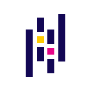
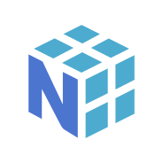
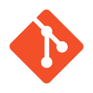

<h1 align="center">Olá, e seja Bem-vindo! 🤖 </h1>

  Estudante de Banco de Dados focado em Análise e Engenharia de Dados

  
  

---

## Sobre mim

📊 Estudante de Tecnologia em Banco de Dados no Mackenzie  
🏪 Empreendedor desde 2021, sempre tomando decisões com base em números (margem, estoque, compras)  
🛠️ Hoje construo pipelines de dados com Python, SQL e PostgreSQL  
🎯 Buscando meu primeiro estágio em Dados, BI ou Analytics  
📍 Rio de Janeiro, RJ

---

## Tecnologias

### Linguagens
<table>
  <tr>
    <td align="center" width="96">
      
       Python
    </td>
    <td align="center" width="96">
      
       SQL
    </td>
  </tr>
</table>

### Bibliotecas
<table>
  <tr>
    <td align="center" width="96">
      
       Pandas
    </td>
    <td align="center" width="96">
      
       NumPy
    </td>
    <td align="center" width="96">
      
       pytest
    </td>
  </tr>
</table>

### Bancos de dados
<table>
  <tr>
    <td align="center" width="96">
      
       PostgreSQL
    </td>
    <td align="center" width="96">
      
       MySQL
    </td>
  </tr>
</table>

### BI e Ferramentas
<table>
  <tr>
    <td align="center" width="96">
      
       Power BI
    </td>
    <td align="center" width="96">
      
       Excel
    </td>
    <td align="center" width="96">
      
       Git
    </td>
    <td align="center" width="96">
      
       GitHub Actions
    </td>
    <td align="center" width="96">
      
       Docker
    </td>
  </tr>
</table>

---

## Projetos em destaque

### [steam-cost-per-hour](https://github.com/thcosta-dados/steam-cost-per-hour)
Quanto me custou cada hora jogada na Steam? Um estudo de caso com os dados da minha própria conta.

- Coleta diária em Python no GitHub Actions desde 23/10/2026, gravando no PostgreSQL (Supabase). O histórico de compras vem de uma página HTML salva, lida com BeautifulSoup
- 34 regras de negócio na especificação, calculadas em views SQL, e painel no Power BI (projeto PBIP) com 5 páginas, drillthrough e medidas DAX
- 83 testes com pytest a cada push, contra um PostgreSQL em container, e 32 consultas SQL que reconciliam cada fato do painel. Os principais números foram conferidos com as páginas da própria Steam
- O SteamID só entra no banco como HMAC-SHA256, e o Row Level Security fecha a API pública do Supabase
- Em 13/11/2026, Rainbow Six Siege saiu a R$ 0,16 por hora, e uma hora de Phasmophobia custou o mesmo que 163 horas de Rainbow Six

### [Duthi E-commerce Analytics](https://github.com/thcosta-dados/duthi-ecommerce-analytics)
Análise de ponta a ponta com dados reais de um e-commerce de semijoias (200 pedidos, jul/2024 a set/2025).

- ETL em Python (Pandas) com validação de chaves e anonimização SHA-256
- Modelo em PostgreSQL com tabela fato, 9 views e 19 queries (CTEs, window functions, cohort de retenção)
- Dashboard em Power BI
- Principal achado: 93% dos clientes compraram uma única vez, o que direcionou a recomendação de foco em recompra

---

## Certificações

- SQL, FGV
- Python for Data Science, AI & Development, IBM (nota 98,5%)
- Data Analytics Essentials, IBM
- Excel Basics for Data Analysis, IBM
- Fundamentos de Engenharia de Dados, DSA
